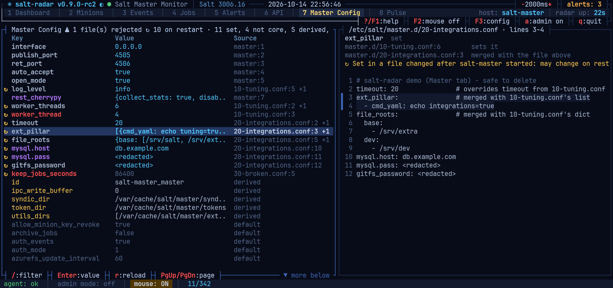
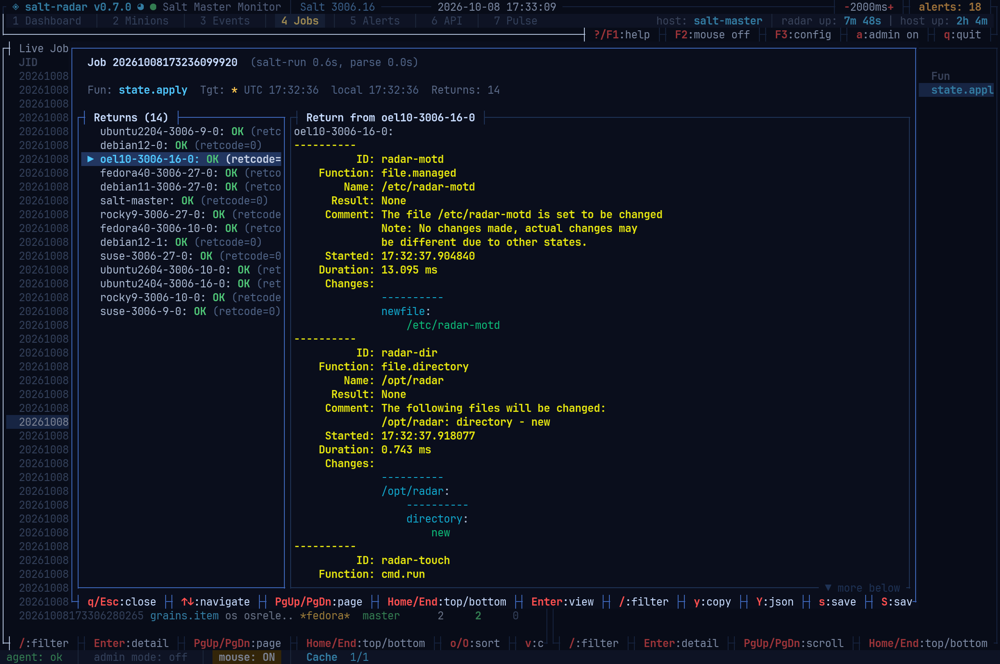
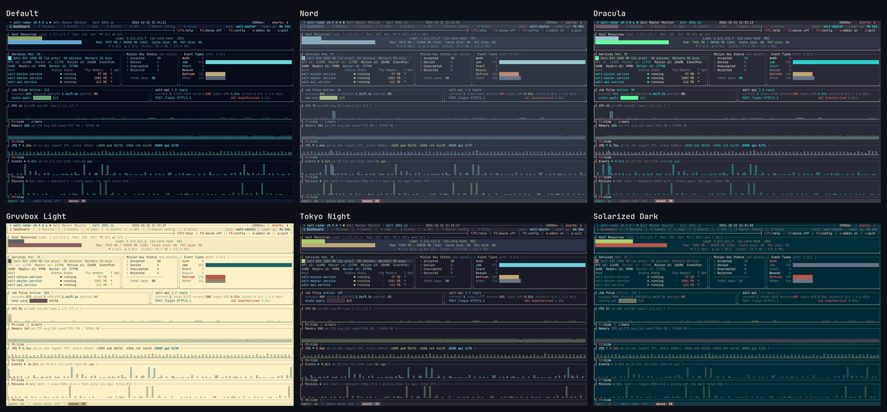

<p align="center">
  
  
  
  
  
</p>

<h1 align="center">salt-radar</h1>

<p align="center">
  <b>A non-intrusive, read-only TUI for monitoring a Salt Master</b><br>
  Built with <a href="https://github.com/ratatui/ratatui">ratatui</a> + <a href="https://github.com/crossterm-rs/crossterm">crossterm</a>
</p>

<br>

salt-radar gives you a live, at-a-glance view of your Salt Master infrastructure — directly in your terminal. It reads from `/proc`, `systemctl`, and Salt's own APIs (via a bundled Python agent) to show you what's happening without needing the Salt CLI or web UI.

No database, no web server, no JavaScript. Just a single binary and a Python agent.

## Screenshots

<table>
<tr><td colspan="2">

**Dashboard** — host resources, real systemd services, minion keys, event types, job pulse, and live ZMQ/event/minion activity sparklines


</td></tr>
<tr>
<td width="50%">

**Minions** — fleet list plus OS/version/arch distribution


</td>
<td width="50%">

**Events** — live event bus stream with pretty-printed detail preview


</td>
</tr>
<tr>
<td width="50%">

**Jobs** — live jobs from the event bus alongside the paginated job cache


</td>
<td width="50%">

**Alerts** — 17 rules covering minion staleness, keys, service health, memory, disk, jobs, auth, and API latency


</td>
</tr>
<tr>
<td width="50%">

**API** — live salt-api request log and per-endpoint breakdown, built from cpstats


</td>
<td width="50%">

**Master Config** — the master's configuration: what each file sets and how they combine, rejected files, typos, and settings a restart would change; credentials redacted


</td>
</tr>
<tr><td colspan="2">

**Pulse** — per-minion return activity at a glance, with connection detail on the side


</td></tr>
<tr><td colspan="2">

**Job Detail** — every minion's return for one job, side by side with its full Salt output; the screen behind any popup is dimmed


</td></tr>
<tr><td colspan="2">

**Themes** — btop++-style color themes, including ports of all of btop's own; shown here: Default, Nord, Dracula, Gruvbox Light, Tokyo Night, Solarized Dark


</td></tr>
</table>

## Features

### Dashboard
Live overview of your Salt Master with real-time sparkline panels:

- **Host Resources** — CPU load, memory usage, disk usage (cache + PKI)
- **Services** — All `salt-*.service` units auto-discovered via systemctl, with active state, memory, uptime, a rolling 24h restart/flap count (`Flp`), and a memory-growth trend arrow (`T`)
- **Minion Key Status** — Accepted / Denied / Unaccepted / Rejected key counts, plus new-pending-keys-per-minute
- **ZMQ** — established connection counts per port (pub/ret/api), plus a latency sparkline whose source is configurable (`zmq_latency_source`): a local agent round-trip (default), a real `test.ping` round-trip over the event bus, or Salt's own `master_stats` instrumentation. The graph uses a log scale up to `zmq_latency_ceiling_ms` — the latency that counts as "bad", drawn red at the top — defaulting per source (100 ms for the agent round-trip, 1 s for `test.ping`, 500 ms for `master_stats`)
- **Event Rate** — Events/sec sparkline with peak and total counters
- **Minion Activity** — Job return rate sparkline with last-active minion tracking
- **Level colors** — the CPU, Memory and ZMQ graphs are colored btop-style by height: each row by how high it sits on the graph's fixed scale, blending green → yellow → amber → red toward the top (Memory has its own calmer cyan → blue → amber → red gradient, as btop's memory meters do), so a bar's color shows how high it reached and the history never recolors. Their headline figures (and the Host Resources meters) use the same smooth gradient instead of hard thresholds, so a value hovering near a boundary doesn't flicker between colors
- **CPU / Memory** — utilization-history sparklines, toggle alongside the other three sparkline panels via `show_*_graph`; stacking order of all five panels is configurable via `graph_order` — in the Config Editor (`F3`, edited as a reorderable list: `↑↓` to select, `+`/`-` to move) or by hand in `salt-radar.toml`
- **Job Pulse** — Active jobs with progress bars, rolling success rate, stuck-job count, and p50/p95 completion latency. Shares a row with salt-api (side by side) when both are shown, since neither needs the terminal's full width; Job Pulse alone takes the full row when salt-api isn't shown
- **salt-api** — shown only when a `salt-api` process is detected; request rate, error rate, `POST /login` p50/p95 latency, in-flight/total request counts, and the most recent request per worker thread (path, status, timing). Needs `rest_cherrypy: {collect_stats: True}` in the master config, plus one of two ways to access the `/stats` endpoint that serves this data — salt-radar polls `GET /stats`, salt-api's own built-in in-memory request-stats endpoint (CherryPy's `cpstats`), which records the request line, client, status and timing entirely in process memory. This is a different mechanism from Salt's `log_level`/access logging: nothing is ever written to disk, and the request *line* it records never includes the body — so credentials sent in a POST body (e.g. `/login`) are never captured. Request rate is a real recent figure (computed by salt-radar from the delta between polls); error rate and login latency are also tracked by salt-radar itself, since cpstats only exposes a lifetime-average rate and a live per-thread snapshot, not cumulative error/latency counters of its own.
  - **`stats_auth_mode = "none"` (default)** — relies on `stats_disable_auth: True` in the master config, so `/stats` needs no credentials at all.
    - **Security tradeoff**: this setting removes Salt's normal auth-token requirement for the `/stats` endpoint specifically, so once enabled, *anyone who can reach salt-api's REST port* can poll `/stats` with no credentials — not just salt-radar. What leaks to that caller: request lines including query strings (so API endpoint paths/usage patterns), client IP:port, response status, and timing — but never request/response bodies or headers, so auth tokens and credentials (including `POST /login` payloads) are never exposed this way. The risk is proportional to how exposed salt-api's port already is: low if it's bound to localhost or a trusted management network, real if it's reachable more broadly. If that matters in your environment, use one of the two authenticated modes below instead, or firewall salt-api's port to trusted hosts.
  - **`stats_auth_mode = "plaintext"` or `"pillar"`** (Config Editor, `F3`, `[api]` section) — the agent logs into salt-api via eauth instead, and sends the resulting token as `X-Auth-Token` on every `/stats` poll. `stats_disable_auth` can stay unset. Both modes need `stats_auth_eauth` (the eauth backend, e.g. `pam`) set:
    - `plaintext` reads `stats_auth_username`/`stats_auth_password` straight out of `salt-radar.toml` — **marked insecure**: stored, and passed to the agent, as plain text.
    - `pillar` instead resolves username and password from two independent colon-delimited pillar paths, `stats_auth_username_pillar_path` and `stats_auth_password_pillar_path` — like two separate `pillar.get` calls (e.g. `salt_radar:api_user` / `salt_radar:api_password` for a pillar shaped `salt_radar: {api_user: ..., api_password: ...}`). Compiled **master-side, for this master's own local minion ID** — the same one `salt-call pillar.get` would resolve on this box (its cached `/etc/salt/minion_id`, same as `salt.config.get_id`), not something you configure — so it's naturally scoped to just this host: a `top.sls` entry keyed to this master's own minion ID (not `'*'`, which would hand the credential to every minion in the fleet) is all that's needed, and no other minion's pillar compilation ever matches it. No live round-trip either way — this reads local pillar SLS files the same way `salt-run pillar.show_pillar` would. Requires a minion co-located with the master (common, but not universal); resolved once and cached (recompiling pillar every poll would be wasteful), and a login that then fails re-resolves it once in case the values rotated in pillar since.
    - **Minimal eauth scope**: salt-api's `/stats` endpoint only checks that the login succeeded — it does **not** consult `external_auth`'s per-function ACL the way `/`, `/run`, `/minions`, etc. do. A dedicated eauth account with an **empty permission list** (e.g. `external_auth: {pam: {stats_monitor: []}}`) can therefore log in and read `/stats`, but that same token is rejected by every actual command-execution endpoint — about as close to a "stats-only" role as Salt's eauth model gets.
    - A stale/rejected token (server restart, `token_expire`) triggers one automatic re-login-and-retry per poll before the panel reports unreachable.
- Every panel above the sparklines — Host Resources, Services, Minion Key Status, Event Types, Job Pulse, salt-api — can be individually hidden via `show_host_resources`/`show_services`/`show_key_status`/`show_event_types`/`show_job_pulse`/`show_salt_api` in the Config Editor (`F3`), same on/off toggle as the sparkline panels' `show_*_graph`; hiding one of Services/Minion Key Status/Event Types reflows the remaining columns in that row to fill the freed width instead of leaving a gap

### Minions
- Scrollable minion list: ID, key status, OS, Salt version, plus optional Proto (auth protocol from the Salt version: v0 red, v2 yellow, v3), Arch, Seen (time since last check-in) and Fail% (share of the minion's last 50 returns that failed, worst first when sorted), Lag and Ping columns; sorting keeps timed-out minions in their own section
- Lag: how slowly the minion answers compared with the other minions on the same jobs, so a minion that's consistently slow stands out whatever the jobs were. For every job with at least two returns, each minion's time from publish to return is divided by the job's median (a `state.apply` and a `test.ping` rate the same way); the column shows the median of the minion's last 50 ratios, gray up to 1.5x, yellow up to 3x, red beyond. A job is rated once every target returned or it passed `job_straggler_secs`, and minions returning later are rated against that median. Return times under 0.5 s count as 0.5 s, so ping jitter doesn't read as lag, and a job where both the minion and the median took under 0.5 s isn't rated at all (it says nothing about lag), so the column shows `—` until the minion has answered a job that took time. Ping: the time to the minion's latest `test.ping` return, from any source. Both fill in from jobs seen while salt-radar runs
- One row per key, so the list adds up to the Dashboard's Minion Key Status: pending, rejected and denied keys are listed too, and an ID with an accepted and a denied key (a minion that came back with a new key) shows twice, once per key
- Freshly-active marker (`●`) next to minions that checked in recently, threshold adapts to the fleet's own median check-in age
- Fleet overview panel: OS Distribution, Salt Version, and Architecture distribution bars
- Detail popup with key info and connection status
- Activity popup (`r`): the minion's recent jobs with function, args, result (OK / FAIL rc=N, or `2 ok 1 chg 1 fail` for state runs) and full JID, plus Job Cache entries that targeted it by name, glob or list; a summary line counts its last 50 returns, names the latest failure and shows the minion's lag (median and p95) and last ping
- Filter by ID, key status (`denied`, `pending`, …), OS, or version (`/` key) — scopes the fleet overview breakdown to the matching minions too, when "follow filter" is on (`f` to toggle, on by default; startup default configurable via `follow_filter` under `[minions]`)

### Events
- Live event stream from the Salt event bus (via ZMQ)
- Local and UTC time columns: only the time for today's events (each column's own today), the full date for older ones, so the tag gets the room; `time_format = "full"` under `[events]` always shows the date (the preview, the detail popup, copies and saves always do), plus an optional Minion column (the event's minion ID)
- Filter by tag, function, minion ID, or any JSON field — a comma-separated list of terms is OR'd together, and each term may be a glob (`web1,web2` or `web*`), mirroring Salt's own `-L`/glob targeting syntax, or a regex wrapped in slashes (`/web-0[1-5]$/`, case-sensitive unless written `/…/i`; a regex is matched against the event's pretty JSON line by line). A `/…/` term that isn't a usable regex, such as one with a `/g` flag or look-around, is matched as plain text and flagged with ⚠ and the reason in the filter bar. Each term of the filter is colored in its own color, in the order typed, from the theme's highlight palette (six colors before any repeat)
- Event detail popup:
  - `t` toggles between raw JSON and a **pretty view** for job-return events — the exact `salt-run jobs.lookup_jid --force-color --state-output=full --state-verbose=True` output (same subprocess call Job Detail uses), so formatting and colors are authoritative Salt output, not an approximation. Falls back to a client-side rendering only when no live fetch is possible (non-job-return events) or after a fetch failure/timeout
  - Copy to clipboard (`y` = tag/timestamp + body, `Y` = body only) matches whatever's currently on screen — pretty or raw
  - `/` searches the event, in whichever view is shown, like Job Detail's output search: matches highlighted (a whole-query `/regex/` works too), `n`/`N` to the next/previous one, the count at the bottom
- Advanced **Event Sniffer** (`n` key) — capture events by comma-separated terms: a minion ID or glob (events from or about those minions, including the jobs that target them), a keyword (anywhere in the tag or data, ignoring case) or a `/regex/` (`/…/i` ignores case; commas and slashes inside it are part of it), e.g. `web-*, nginx, /ret/(db|web)\d+/`; each term colors its matches:
  - An invalid regex keeps the prompt open and says what's wrong
  - `h` narrows the shown list to events matching further keywords or `/regex/` terms (empty input shows everything again)
  - Pause/resume live capture (`p`)
  - Navigate events with full pretty-printed JSON body
  - Open event detail from sniffer (`Enter`), return to sniffer on close
  - Copy captured (and currently filtered/shown) events to clipboard (`y`), or save them to file (`s`)

### Jobs
- Split panel: **Live Jobs** (left) from event bus and **Job Cache** (right) from Salt's master job cache
- Job cache supports pagination (`[`/`]` adjust limit, `,`/`.` page navigation) and server-side search — the same terms as the other filters (comma-separated, globs matched against the target, `/regex/`), applied by the agent across the whole cache; its regexes use Python's `re`, which differs slightly from the other filters' regex dialect (e.g. lookarounds work only here)
- **Args** column shows what a job was run with: for `state.apply`/`state.sls` the requested formula (e.g. `apache.install`), `highstate` when none was named, and a dimmed `(test)` marker for `test=True` dry runs; for other functions their arguments (e.g. `uptime` for `cmd.run`). The `/` filter matches it too
- Sortable and configurable columns (see [Columns and sorting](#columns-and-sorting)) — the Job Cache is sorted across the whole cache by the agent, not just the page on screen
- Default order (no sort column picked): Live Jobs run oldest to newest by JID, tail-style like Events — the cursor stays on the newest job as new ones arrive, until you move it (`End` resumes following); the Job Cache lists newest first
- Per-minion return navigation (j/k), scrollable output viewer (Enter)
- Copy return output to clipboard (y = Salt outputter format, Y = raw JSON), or save it to file (s/S, same two formats)
- Jobs with hundreds of returns aren't limited to one minion at a time: `a`/`A` save every return in the job to a single file (Salt outputter format / one JSON object keyed by minion id), from the return list
- Job detail popup shows correct OK/FAIL status derived from return values
- Always shows full per-state detail (`--state-output=full --state-verbose=True`), regardless of the master's own `state_output`/`state_verbose` defaults — opening the popup is an explicit request to see everything about that one job, even a "terse"/"changes" master would otherwise hide unchanged/no-op states here

### Alerts
17 rules, evaluated every tick and de-duplicated (repeat firings bump a counter instead of spamming new entries). `Enter` opens an alert's detail: severity, rule and the description (wrapped) stay at the top, the affected items (minions, units, jobs) scroll below them, and `/` searches them:

- **Stale minion** — not seen within `stale_minion_secs`
- **Pending key** — pending longer than `pending_key_secs`
- **Service down** — a discovered `salt-*.service` unit is inactive
- **Disk usage high** — cache or PKI disk over `disk_usage_pct`
- **No replay protection** — minions on Salt's auth protocol v0, from before the March 2022 security releases (2014.x–3001.x, 3002.0–3002.7, 3003.0–3003.3, 3004.0)
- **Legacy auth protocol** — minions on protocol v2, without per-minion session encryption (3002.8+, 3003.4+, 3004.1+, 3005, 3006.0–3006.11, 3007.0–3007.3)
- Both go by this master's `minimum_auth_version` as the running master holds it (asked of the master, as for the Master Config tab; the files' value when it can't be asked): **critical** when it rejects those minions, so they can't connect; a **warning** when it's lowered to let them in, as they still lack replay protection (v0) or per-minion session encryption (v2); and a **warning** on a master that doesn't enforce it yet, as masters from 3006.17, 3007.9 and 3008 reject v0 and v2 by default (`minimum_auth_version: 3`)
- **Config file rejected** — a master config file Salt couldn't parse (e.g. the same key twice): Salt skips the whole file with only a log line, so all its settings silently fall back to their defaults; critical (see the Master Config tab)
- **Minion newer than master** — minions on a newer Salt major than the master (e.g. 3008 minions on a 3006 master); older minions are supported, and the protocol rules cover the ones too old
- **Salt warning** — `salt/warning/*` events on the bus
- **Auth failure** — failed authentication on the ZMQ bus
- **Stuck job** — dispatched but not fully returned within `job_straggler_secs`
- **Reauth storm** — auth rate and worker-pool saturation elevated together (`auth_storm_rate_per_sec`, `worker_saturation_pct`)
- **Pending key churn** — new pending keys arriving faster than `pending_key_churn_per_min`
- **Service flapping** — a unit restarted more than `service_flap_threshold_24h` times in 24h
- **Service memory growth** — sustained upward memory slope past `service_mem_growth_mb_per_hour`, independent of flapping
- **Service memory high** — a unit's current RSS crosses an absolute (`service_mem_abs_threshold_mb`) or percent-of-total-memory (`service_mem_pct_threshold`) threshold, independent of growth rate; salt-master/minion/api/syndic can each override these globals (e.g. `service_mem_abs_threshold_master_mb`)
- **API auth latency** — salt-api's `POST /login` p95 processing time crosses `api_auth_latency_warn_secs`, a common early symptom of PAM/LDAP/eauth backend trouble (needs the salt-api panel's `collect_stats` setup — see Dashboard above)

All thresholds are configurable via `salt-radar.toml` or the in-app Config Editor (`F3`).

### API
Shown only once salt-api's `/stats` is reachable (see Dashboard above for the `collect_stats` setup and the `stats_disable_auth`/`stats_auth_mode` access options):

- Live request log — age, method, client, path, status, timing — built by salt-radar itself from cpstats' per-thread snapshots (filterable by `/`); `Enter` opens a detail popup with the full request line (query string included), client, status, and processing time
- Per-endpoint breakdown — request count, avg/p95 latency, error rate, grouped by method+path
- Best-effort, not a complete record: cpstats only ever exposes the *latest* request per CherryPy worker thread, so a thread that completes more than one request between two polls only shows the last one
- Bounded two ways, both configurable under `[api]` (`log_cap`, default 1000; `log_max_age_secs`, default 3600): capped at `log_cap` entries, and entries older than `log_max_age_secs` are pruned every poll regardless of how full the log is. The salt-api panel's own error-rate/login-latency rolling window (`stats_window`, default 200 requests) lives in the same section.
- Only what cpstats records is ever visible: no request/response body, no headers — so no credentials, payload content, or which minion/job/user was involved
- salt-radar's own `GET /stats` poll (the request that populates this log) is filtered out by default — `hide_stats_polls` (`[api]`, default `true`) — since at the Dashboard refresh interval it would otherwise drown out real traffic with one entry per tick. Set to `false`, or press `x` on the API tab to toggle it live — the filter applies at display time, so it hides/shows already-captured entries retroactively, not just ones captured from that point on. `/stats` requests are still always captured and still count against `log_cap`/`log_max_age_secs` even while hidden — this only controls what's shown.

### Master Config
The master's configuration, as its files set it:

- Every setting, collapsed to one line: the ones set in a file first, in Salt's load order (`/etc/salt/master`, then `master.d/*.conf` sorted, then `include:`), with the file and line that sets each; then values Salt worked out at startup (derived); then the defaults, greyed out. `/` filters by name, value, file or kind (`set`, `module`, `not core`, `derived`, `default`), and module settings by what reads them (`salt-api`, `eauth`)
- The right panel shows the file the selected setting comes from, its block marked, and, when several files set it, what each one does, following Salt's own rules:
  - a `master.d` file **replaces** the main file's whole value: a nested key it doesn't set is dropped, and the panel names it (`rest_cherrypy: {port: 9000}` in `master.d` drops every other `rest_cherrypy` option from `/etc/salt/master`); `include:` files replace `master.d` ones the same way
  - between `master.d` files, dicts are **merged** and lists concatenated (two `ext_pillar` entries give both), while other values are **overridden** by the later file
- `Enter` opens the full value next to Salt's default, and when several files set it, each file's own value before the result; `y` copies it as YAML, `s` saves it
- **Rejected files** — a file Salt can't parse (the same key twice is enough) is skipped whole, with only a log line. The title says so, its settings are listed as **ignored** with Salt's reason (named from its top-level lines when the file isn't valid YAML at all), the line at fault is marked in the file, and the "Config file rejected" alert fires
- **Module** — a key that isn't salt-master's own but that Salt still reads, named with what reads it and where that comes from: salt-api (`rest_cherrypy`, `rest_tornado`, `rest_wsgi`, `api_logfile`, `rest_timeout`), a module's option (`auth.ldap.uri` with the backend's default, `cache.redis.host`, `mysql.host`, a returner's `pgjsonb.host` or `alternative.pgjsonb.host`, `vault`), or a valid minion, syndic or salt-ssh option. Modules are found where the master's loader finds them: Salt itself, installed Salt extensions (`saltext-vault`) and synced custom modules, and a dotted option only counts when the module's source names it, so `redis.host` on a 3008 master, whose redis cache reads `cache.redis.host`, is caught (did you mean `cache.redis.host`). A setting for one of the modules Salt 3008 moved out to extensions says so while the extension isn't installed. Options inside `rest_cherrypy`/`rest_tornado`/`rest_wsgi` are checked against what salt-api reads: one it doesn't is flagged, with a near miss named (`colect_stats` → `collect_stats`), and so is the documented `socket_queue_size`, which salt-api 3006 never reads (it reads `queue_size`)
- **Not core** — a key in a file that nothing in Salt reads: a typo, which Salt silently ignores; a near miss names the setting it's probably meant to be (`worker_thread` → did you mean `worker_threads`). The title's count includes ignored keys inside a salt-api section
- **↻ may change on restart** — the setting's value in the files differs from the one the running master holds, so a restart will change it; the title counts them (`↻ 10 on restart`) and `/restart` lists them. The running master's own options are asked of it (the `test.get_opts` runner, sent to the master so it runs in a process forked from its worker, once per master start and salt-radar instance). That's an ordinary runner job: its return, the master's options as loaded, credentials included, goes over the event bus and into the job cache like any other job's return (pillar data in state returns, for one), so whoever can read those -- the job cache's files, salt-api's `/events` stream, an `event_return` or external job cache -- can read it too. salt-radar keeps this job of its own out of Events, Live Jobs and the Job Cache list; `salt-run jobs.list_jobs` still shows it, as `runner.test.get_opts`. To harden this, set `running_config_digests = true` under `[salt]` (or in the Config Editor): the master is then asked only for a SHA-256 digest of each option (the `salt.cmd` runner rendering a template in its own process), compared with digests of the files' options, so no option value leaves it; ↻ marks the same settings, but the panel can't show what the running master holds. compared value by value with the files as Salt loads them, and the panel and the popup show the running value next to why: **changed** after the master started, **restored** (it differs although its files are older than the master: put back with their old time, or edited keeping it), or **removed** from the files while the master still has it. A file only touched, or rewritten with the same values, isn't marked. When the master can't be asked (not running, the request refused), ↻ falls back to settings in files changed after the master started, and the title says `(file times only)`. The master's start is taken from the salt-master processes themselves, not from anything mentioning salt-master (a `journalctl -u salt-master -f` left running made the master look older than it was)
- Credentials are redacted by the agent before they reach the TUI, in the list, the files, the popup and copies: values of keys like `*pass*`, `*password*`, `*secret*`, `*token`, `*_key` (nested ones too, as in `ext_pillar`), except flags and file paths, and the password or token in any URL, wherever it is (`https://deploy:<redacted>@github.com/...` in `gitfs_remotes`, `ext_pillar` or a comment)
- Read from the files at start, with the config refresh (`config_secs`) and on `r`

### Pulse
- Per-minion return activity at a glance: every minion as a dot in a wrapped grid, color- *and* shape-tiered by recency (`●` bright green flash → `•` green → `·` orange → `·` grey → `·` red for timed out) so adjacent tiers stay distinguishable even at a glance
- Scales from a handful of minions to 4,000+ without layout changes
- Detail panel on the side: key status, connection status, OS, Salt version, last return time

### Admin Mode
- Toggle with `a` (danger-zone confirmation dialog required)
- **Fleet scan** (`s`): runs `grains.items` on all minions via Salt LocalClient, populates OS/Salt Version/Arch data; it finishes as soon as every minion has answered, and marks any still silent after 60s as timed out

### Columns and sorting
- The Minions, Events, Jobs (both tables), Alerts and API request log tables let you choose which columns are shown and in what order: `v` opens a picker for the focused table (`+`/`-` move a column, `Space` shows/hides it, `Enter` saves), also editable in the Config Editor — `minion_columns`, `event_columns`, `live_columns`/`cache_columns`, `alert_columns` and `request_columns` in their sections of `salt-radar.toml`
- Every table except Events (a live tail that follows the newest event) sorts by any column: click its header, or `o` to step through columns and `O` to reverse — ascending, descending, then back to the default order (Minions by ID, Live Jobs oldest-to-newest and Job Cache newest-first by JID, Alerts and the API log in arrival order). Sorting lasts for the session
- Optional columns beyond the defaults: Live Jobs and Job Cache Started (the JID already holds the start time), Minions Proto/Arch/Seen/Fail%/Lag/Ping, Events Minion, Alerts Since/Count
- When a panel is too narrow for every column, the text columns shrink together instead of cutting off the rightmost ones

### Config Editor
- `F3` opens an in-app editor for every setting in `salt-radar.toml`, grouped by section
- Free-text fields edit inline; fields with a fixed set of valid values (e.g. `zmq_latency_source`) open an inline picker — arrow keys to move, `Enter` to confirm
- Settings that must point at something existing — `agent_path`, `python_bin`, `master_config` (files) and `save_dir` (a directory) — open a file browser instead of free text, starting at the current value (or the nearest folder that exists): `↑↓` to move, `Enter`/`→` to open a folder or pick a file, `←`/`Backspace` up a level, `.` to show hidden files, and for `save_dir` a "select this directory" entry; type the start of a name to jump to it, and `/` lets you type a path by hand. A path that doesn't exist is flagged `✗ not found` in the editor, so typos stand out
- `color_theme` opens a picker of every theme found (see [Themes](#themes)) and previews each one live as you move through the list; `Esc`, or closing without saving, puts the saved theme back
- `graph_order` opens as a reorderable list instead of free text — `↑↓` selects an item, `+`/`-` moves it up/down, `Enter` confirms, `Esc` reverts — since hand-typing a comma-separated list makes it easy to typo or drop a panel
- The `*_columns` settings open the same way, plus `Space` to show/hide a column (hidden columns are listed unchecked below the shown ones)
- The hotkey toggles are settings too and are saved the moment they change, so the next start looks the same however the session ended (a clean quit, a closed terminal window, a dropped SSH session): the Dashboard graphs (`F4`–`F8`, `show_*_graph`) and their style (`m`, `graph_style` = dots/bars), mouse capture (`F2`, `mouse`), the refresh speed (`-`/`+`, `tick_ms`), the Minions `f` follow filter, the API `x` stats-poll filter and where `Ctrl+←`/`→` left each tab's panel divider (`*_split_pct` in `[ui]`, 20-80%). Saving merges them into the file as it is, so it doesn't undo other edits made to it meanwhile
- `Save & Restart` (or `s` from anywhere in the editor) writes the TOML file and applies the new config immediately, no process restart needed. Only settings that differ from the defaults are written, so everything you haven't changed keeps following the defaults of future versions (a file saved by an older version, which held every setting, slims down on its next save). Confirming a field with `Enter` only stages it — the title shows `● unsaved changes` until saved, and closing with unsaved changes asks first (`Esc`/`q` again discards)

### Clipboard and save-to-file

Every popup with copy-to-clipboard (`y` / `Y`) also supports saving the same content to a file (`s` / `S`) — a small dialog opens on top of the popup, proposing a filename from what's being saved; edit it, `Enter` saves (warning first if the file already exists), `Esc` cancels. JSON saves (`S`, and `A` for all of a job's returns) get a `.json` name, text saves `.txt`. Default save directory is `~` (the launching user's home), configurable as `save_dir` under `[export]` (or live, in the Config Editor).

Copy-to-clipboard (`y` / `Y`) uses two methods:

1. **tmux load-buffer** — pushes text into the tmux paste buffer via OSC 52 escape sequence. MobaXterm (or any terminal emulator that handles OSC 52) captures this and places it on the system clipboard. Works automatically when running inside tmux. Requires `set -g set-clipboard on` in `~/.tmux.conf` to push to the system clipboard (without it, content is only available via `Ctrl+b ]` inside tmux).

2. **xclip** — pushes text to the X11 clipboard via `su` as the user that owns the X11 socket. The code auto-resolves DISPLAY and XAUTHORITY by checking the process environment first, then falling back to the tmux session's global environment, and finally trying the detected user's default `~/.Xauthority` path. This means clipboard works even when salt-radar is launched under `sudo`, with no `sudoers` configuration required.

If DISPLAY and XAUTHORITY can't be resolved, a transient yellow hint is shown in the status bar explaining that X11 clipboard is unavailable. Run with `ssh -X` or `ssh -Y` to enable X11 forwarding.

### Everywhere
- **Color themes** — btop++-style `.theme` files (see below); the screen behind any popup is dimmed so the popup stands out — how strongly is `popup_dim_pct` in `[ui]` (default 70%, `0` turns it off)
- **Clipboard integration** — tmux load-buffer + xclip via X11 forwarding. DISPLAY and XAUTHORITY are auto-resolved from the process environment or the tmux session's global environment — no manual configuration needed even when running under `sudo`
- Filter-as-you-type with `/` on all list tabs — each tab keeps its own filter independently, comma-separated terms (each optionally a glob, or a `/regex/`) are OR'd together, and matched terms are colored, each in its own color; text that isn't a complete `/…/` is plain, so a filter being typed never errors. Job Detail's output search and the help search take a whole-query `/regex/` the same way (`/etc/salt/minion` stays a plain path search), and a match may span differently colored parts of a line
- Keyboard-driven navigation with `?` for help

## Installation

### Requirements
- A Salt Master (reads `/etc/salt/master`, connects to the Salt event bus)
- Python 3 with the `salt` package installed
- **Optional — clipboard:** `xclip` (for X11 clipboard integration). Not required when using tmux with `set -g set-clipboard on` and a terminal that supports OSC 52 (MobaXterm, iTerm2, etc.)

### From a release package

Each [GitHub release](https://github.com/naqoyqatsi83/salt-radar/releases) has a `.deb`, an `.rpm` and a `.tar.gz`, all with the same statically linked binary, so it runs on any x86_64 master regardless of its glibc version:

```bash
sudo apt install ./salt-radar_<version>_amd64.deb      # Debian/Ubuntu
sudo dnf install ./salt-radar-<version>-1.x86_64.rpm   # RHEL/Rocky/Fedora/SUSE (or rpm -i)
```

The packages install `/usr/bin/salt-radar`, the Python agent at `/usr/share/salt-radar/salt_radar_agent.py`, and the bundled themes in `/usr/share/salt-radar/themes/` — the built-in config defaults already point at these, so no config file is needed to start. The `.tar.gz` holds the same three pieces for a manual install; put its `themes/` files in `/usr/share/salt-radar/themes/` or `~/.config/salt-radar/themes/`.

### From source

```bash
git clone https://github.com/naqoyqatsi83/salt-radar.git
cd salt-radar
cargo build --release
```

The binary will be at `target/release/salt-radar`.

### Configuration

Copy the example config and adjust as needed:

```bash
cp salt-radar.toml.example salt-radar.toml
```

All settings are optional and can also be edited live from inside the app (`F3`), which writes the file back on save — the Config Editor's own bottom border shows exactly which file it's writing to. salt-radar looks for `./salt-radar.toml` in the current directory first (so a per-directory config still works, e.g. if you copied the example there); if that's not present, it falls back to `$XDG_CONFIG_HOME/salt-radar/salt-radar.toml` (usually `~/.config/salt-radar/salt-radar.toml`), creating the directory on first save. See [`salt-radar.toml.example`](salt-radar.toml.example) for the complete, commented list of every setting (connection paths, refresh intervals, event buffer sizes, all alert thresholds including per-unit memory overrides, and the Dashboard's `zmq_latency_source`/`show_*_graph`/`graph_order` settings) — a representative slice:

```toml
[salt]
# master_config = "/etc/salt/master"

[refresh]
dashboard_secs = 2

[alerts]
stale_minion_secs = 3600
disk_usage_pct = 85.0
service_mem_abs_threshold_mb = 2048.0

[dashboard]
zmq_latency_source = "agent_ipc"  # or "job_ping", "master_stats"
```

#### Slow links (SSH proxies that record sessions)

On a busy master, every list scrolls on every refresh, and a scrolled panel is redrawn row by row; the Dashboard graphs shift one column each refresh, so once they're full nearly every graph cell is redrawn too. That's a few KB/s, which a direct SSH session doesn't notice, but a proxy that records sessions (CyberArk PSM, for one) can fall behind it, and then the whole connection lags, tmux and other windows on it included. Set `max_output_kbs` under `[refresh]` (e.g. 4–8) to cap what salt-radar sends: over the cap, refreshes wait until it allows them, while key presses still redraw at once. The header shows the cap (`≤4KB/s`), yellow while a refresh is waiting. Hiding the graphs (`F4`–`F8`) or a slower refresh (`+`) cuts the output too.

#### Running through sudo, and several users at once

salt-radar needs root (or the Salt user) to read the master's PKI and job cache, so it's often started with `sudo`. sudo resets `HOME` to root's, which would make every user share root's config — so when salt-radar runs as root with `SUDO_USER` set, it uses the invoking user's files instead: their `~/.config/salt-radar/salt-radar.toml` (a user without one yet starts from root's config, or the defaults, and their first save creates their own), their `~/.config/salt-radar/themes/`, their "updated to vX" marker, and their home for `~` (e.g. the default export directory). Whatever salt-radar creates in their home is owned by them. `./salt-radar.toml` in the current directory still wins, and `sudo -i` or a real root login behave as before. Config saves are atomic (a temp file renamed into place).

Several users can run salt-radar on the same master at the same time: each instance starts its own agent and talks only to it, and nothing is locked or written into Salt's directories. What adds up is load — each agent takes about 60 MB and runs its own polling (`systemctl`, `/proc`, keys, salt-api `/stats`), plus Job Cache loads and Job Detail lookups when someone uses them. The only things that reach minions are admin-mode actions (fleet scan, minion ping, grains) and the opt-in `job_ping` latency source (a `test.ping` to every minion every few seconds), so with several users keep `zmq_latency_source` on its default. Each instance's Job Detail lookups are real runner jobs (`jobs.lookup_jid`), so users see each other's in Live Jobs and Events.

### Themes

Colors come from a theme, picked with `color_theme` in the `[ui]` section (or in the Config Editor, which previews each theme live as you scroll the list, like btop's options menu). The built-in theme is `Default`; the package also ships ports of all of btop++'s bundled themes (Nord, Dracula, Gruvbox, Tokyo Night, Solarized, Everforest, Kanagawa, … and `btop` itself), plus `1337` (from the 1337 color scheme), in `/usr/share/salt-radar/themes/`, and your own `*.theme` files go in `~/.config/salt-radar/themes/` (the user's copy wins on a name clash), and `color_theme` can also be a path to a theme file. The format is the same as btop++'s — `theme[key]="#RRGGBB"` lines, and any key a theme leaves out keeps its Default color. [`salt-radar.theme.example`](salt-radar.theme.example) is the Default theme with every key documented; copy it to `~/.config/salt-radar/themes/<name>.theme` to start your own. Set `theme_background = false` to keep your terminal's own (e.g. transparent) background instead of the theme's.

## Keyboard Shortcuts

| Key | Action |
|-----|--------|
| `q` | Quit (asks first unless `confirm_quit = false`; `Ctrl+C` quits at once) |
| `Tab` / `Shift+Tab` | Next / previous tab |
| `1`–`8` | Jump to tab (Dashboard/Minions/Events/Jobs/Alerts/API/Master Config/Pulse) |
| `↑`/`↓` | Scroll / navigate |
| `PgUp`/`PgDn` | Page scroll |
| `Home`/`End` | First/last row |
| `Enter` | Open detail popup |
| `Esc` | Close popup / help |
| `/` | Filter (current tab) |
| `a` | Toggle admin mode |
| `?` / `F1` | Help overlay; `Tab` / `←` / `→` switch its pages (`Shift+Tab` back): Keys, Guide (filter, search and sniffer syntax, panel notes) and What's new (the changelog) |
| `F2` | Toggle mouse mode |
| `F3` | Open Config Editor |
| `+`/`-` | Adjust refresh interval |
| `m` | Toggle sparkline style (Dashboard) |
| `Ctrl+←`/`Ctrl+→` | Move the divider between the two panels (Minions, Events, Jobs, API, Master Config, Pulse) |
| `F4`–`F8` | Toggle CPU/Memory/ZMQ/Events/Minion-activity graphs (Dashboard) |

Most of these are also shown live, btop-style, in the border of the panel they affect (e.g. the title frame's bottom border shows `-2000ms+` for the current refresh interval) — the table above is the full reference.

### Per-tab

| Tab | Key | Action |
|-----|-----|--------|
| Events | `n` | Launch event sniffer |
| Events | `s` / `S` | Save the filtered event list to a file (text / NDJSON) |
| Minions | `r` | Minion event/return history popup |
| Minions | `s` | Fleet scan (admin mode only) |
| Minions | `x` | Hide/show non-responsive minions |
| Minions | `z` | Collapse/expand timed-out minions into one row (when not hidden) |
| Minions | `f` | Toggle whether the Fleet Overview breakdown follows the active list filter |
| Minions, Jobs, Alerts, API | `o` / `O` | Sort by the next column / reverse the sort (also: click a column header) |
| Minions, Events, Jobs, Alerts, API | `v` | Choose which columns the focused table shows, and their order |
| Jobs (Live) | `x` | Show only failed jobs / all jobs |
| Jobs (Cache) | `/` | Filter cache entries (server-side) |
| Jobs (Cache) | `[`/`]` | Decrease/increase page limit by 500 |
| Jobs (Cache) | `,`/`.` | Previous/next page |
| Jobs (Cache) | `r` | Refresh job cache |
| Jobs (Cache) | `←`/`→` | Switch focus between Live Jobs and Cache panels |
| Pulse | `↑`/`↓`/`←`/`→` | Navigate the minion grid |
| Master Config | `Enter` | The setting's full value, where it's set and Salt's default |
| Master Config | `r` | Read the configuration files again |
| API | `x` | Hide/show salt-radar's own `GET /stats` poll in the request log (hidden by default — see `hide_stats_polls`) |

### Config Editor

| Key | Action |
|-----|--------|
| `↑`/`↓` | Move between fields |
| `PgUp`/`PgDn` | Page through fields |
| `Home`/`End` | First/last field |
| `Enter` | Edit field / open picker (fixed-option fields) or file browser (path fields) / confirm picker selection |
| `Esc` | Cancel edit or close the picker without changing the value |
| `s` | Save all changes and apply them |
| `←` / `Backspace` | Up one folder (file browser) |
| `.` | Show/hide hidden files (file browser; while not typing a name) |
| `/` | Type the path by hand (file browser) |
| letters, digits | Jump to the first entry starting with what you type (file browser) |

### Popups

| Key | Action |
|-----|--------|
| `y` | Copy to clipboard |
| `Y` | Copy raw JSON (job detail) |
| `s` | Save to file |
| `S` | Save raw JSON to file (job detail; NDJSON in the sniffer) |
| `a` | Save every return in the job to one file (job detail) |
| `A` | Save every return as one JSON object (job detail) |
| `j`/`k` | Next/previous return (job detail) |
| `PgUp`/`PgDn` | Jump 10 returns |
| `Home`/`End` | First/last return (job detail) |
| `Enter` | Enter scroll mode (event/job detail) |
| `/` | Search the return output (job detail, output pane), an event (event detail, raw or pretty view), an alert's items (alert detail) or the help pages, matches highlighted |
| `n`/`N` | Next/previous search match, marked in place (job detail, also from the returns list; event detail; alert detail; help) |
| `f`/`F` | Next/previous failed state, marked in the output (job detail; also from the returns list) |
| `Esc` | Exit scroll mode |
| `Home`/`End` | Jump to start/end of output (scroll mode) |
| `t` | Toggle raw JSON / pretty view (event detail) |
| `h` | Show only events matching keywords or `/regex/` terms (sniffer) |
| `p` | Pause/resume (sniffer) |
| `g` | Fetch grains for this minion (minion detail, admin mode only) |

## How It Works

```
┌────────────────────────────────────────────────────────────────────┐
│                       salt-radar (Rust TUI)                        │
├─────────┬─────────┬─────────┬─────────┬─────────┬─────────┬────────┤
│Dashboard│ Minions │  Events │   Jobs  │  Alerts │   API   │ Pulse  │
├─────────┴─────────┴─────────┴─────────┴─────────┴─────────┴────────┤
│ detail popups · Config Editor · themes · alert engine              │
│ collectors: /proc · systemctl · /proc/net/tcp · PKI key dir        │
└───────────────┬─────────────────────────────────┴──────────────────┘
                │ commands                        ▲ results, events
                │ (stdin)                         │ (stdout)
                │                                 │
┌───────────────▼─────────────────────────────────┴──────────────────┐
│              Python agent (runs on Salt's own Python)              │
│ event bus subscriber · LocalClient / runners · fleet scan          │
│ job cache reader · jobs.lookup_jid · salt-api /stats poller        │
└──────────────────────────────────┬─────────────────────────────────┘
                                   │
┌──────────────────────────────────▼─────────────────────────────────┐
│        Salt Master: event bus · job cache · PKI · salt-api         │
└────────────────────────────────────────────────────────────────────┘
```

The Rust TUI spawns a Python agent subprocess and talks to it in NDJSON: commands go to the agent's stdin, results and Salt events come back on its stdout. The agent runs on Salt's own Python, subscribes to the master's local event bus, and calls Salt's LocalClient and runners (job lookups, the job cache, fleet scans) — plus salt-api's `/stats` endpoint for the API tab. Meanwhile, the Rust side collects host data itself: processes and memory from `/proc`, services from `systemctl`, ZMQ connection counts from `/proc/net/tcp`, and minion keys straight from the PKI directory.

All data stays local — no external dependencies, no database, no HTTP server.

### A note on the two memory numbers on the Dashboard

The **Services** panel shows two different memory readings that measure different
things and are not expected to match:

- **Per-role breakdown** (`Master x4: 212MB`, `Worker x5: 299MB`, etc.) — the sum
  of each individual process's own RSS (`/proc/<pid>/stat`), independently, across
  every process matching that role. Since Salt's Worker/ReqServer/EventPublisher
  children are forked from the master and share most of their loaded code/library
  pages with it via copy-on-write, summing their RSS independently counts those
  shared pages once per process — so this number is a reasonable *upper bound*,
  not the service's true footprint.
- **`Unit` table memory** (`salt-master.service 51 MB`) — the systemd unit's
  cgroup memory accounting (`MemoryCurrent`), which counts each physical page
  once no matter how many of the service's processes share it, and covers the
  whole process tree (main daemon plus all forked children). This is the more
  accurate figure for "how much RAM does this service actually cost."

If cgroup memory accounting isn't available for a unit, the `Unit` table falls
back to the main process's own `VmRSS`, which — like the per-role breakdown —
only reflects that one process, not its forked children.

## Development

```bash
# Build
cargo build

# Run with live config
cargo run

# Release build
cargo build --release
```

### Project Structure

```
src/
├── main.rs              # Terminal setup, event loop, tick scheduling
├── app/                 # Application state and behavior
│   ├── mod.rs           # App state, tick/update loop, filtering and sorting, job tracking
│   ├── keys.rs          # Keyboard and mouse input for tabs, lists and every popup
│   ├── messages.rs      # Agent results/events in, agent commands out, fleet scan
│   ├── config_editor.rs # Config Editor: field model, path browser, saving, theme preview
│   └── clipboard.rs     # Clipboard (tmux/OSC 52, X11 via xclip) and save-to-file
├── types.rs             # Data types (minion, event, job, alert, etc.)
├── config.rs            # TOML config loading, theme discovery and parsing
├── agent.rs             # Python agent subprocess management
├── alerts/              # Alert engine (17 rules: staleness, keys, services, memory, disk, jobs, auth, api)
├── collectors/          # OS-level data collection
│   ├── keys.rs          # PKI key file parsing
│   ├── processes.rs     # /proc scanning for salt processes
│   ├── services.rs      # systemctl service discovery
│   ├── connections.rs   # /proc/net/tcp for ZMQ connections
│   └── system.rs        # System load, memory, disk usage
└── ui/                  # Terminal UI
    ├── mod.rs           # Master draw, theme, title/tab frame, key hints, help
    ├── dashboard.rs     # Dashboard tab
    ├── minions.rs       # Minions tab
    ├── events.rs        # Events tab
    ├── jobs.rs          # Jobs tab
    ├── alerts_view.rs   # Alerts tab
    ├── api_view.rs      # API tab
    ├── pulse.rs         # Pulse tab
    ├── table.rs         # Shared table layout: column widths, headers, sort markers
    ├── minion_events.rs # Per-minion event/return history popup
    ├── config_editor.rs # In-app config editor (F3)
    └── detail_popup.rs  # All other popup windows (minion, event, job, sniffer, etc.)
agent/
└── salt_radar_agent.py  # Python agent: Salt client, event subscriber, fleet scan
themes/                  # Bundled color themes (ports of btop++'s), installed to /usr/share/salt-radar/themes
salt-radar.theme.example # The Default theme with every key documented
```

## Acknowledgements

salt-radar stands on the shoulders of other people's work:

- **[btop++](https://github.com/aristocratos/btop)** by Jakob P. Liljenberg ([aristocratos](https://github.com/aristocratos)) — a huge thank-you for the inspiration and for such great work. A lot of salt-radar's look and feel comes straight from btop: shortcut hints living in the panel borders, braille sparklines, graphs colored by level, and the whole theme system — the `.theme` file format is btop's, and the bundled themes are ports of btop's own (Apache-2.0) — all but `1337`, made from the palette of the 1337 color scheme ([IntelliJ port](https://github.com/2chevskii/intellij-theme-1337)). If you like salt-radar, go give btop a star.
- **The theme authors** — every bundled theme is a port of a btop theme and keeps its original author's credit at the top of the file, and most of them carry a well-known color scheme by its own designers (Nord, Dracula, Gruvbox, Solarized, Tokyo Night, Everforest, Kanagawa, Flexoki and more).
- **[psnet](https://github.com/psmux/psnet)** — salt-radar's original dark palette, its ratatui TUI style, and its `/proc` / `/proc/net/tcp` collection approach were modeled on psnet.
- **[ratatui](https://github.com/ratatui/ratatui)** and **[crossterm](https://github.com/crossterm-rs/crossterm)**, which do the heavy lifting of drawing to the terminal, plus serde, serde_json, toml, chrono, base64 and libc.
- **[Salt](https://github.com/saltstack/salt)** itself — the Python agent uses nothing beyond Python's standard library and Salt's own client APIs.

## License

MIT — see [LICENSE](LICENSE).

salt-radar is not affiliated with or endorsed by SaltStack / VMware / Broadcom.
