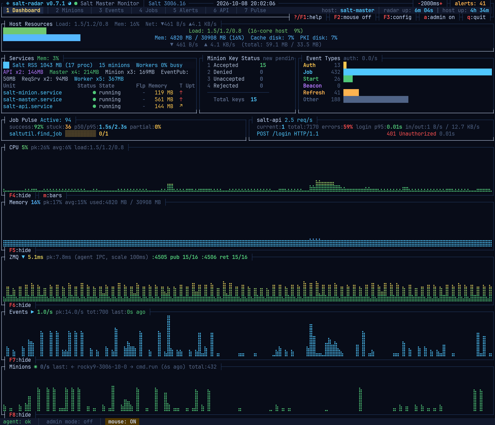
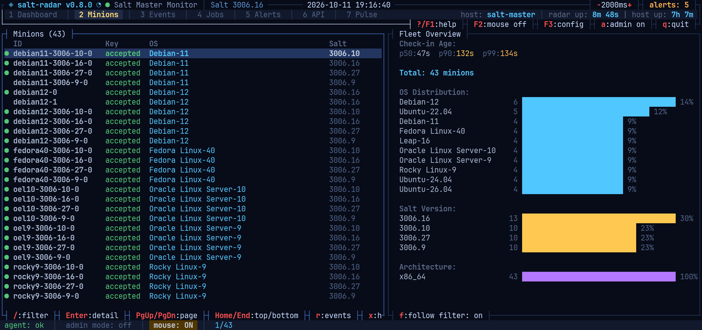
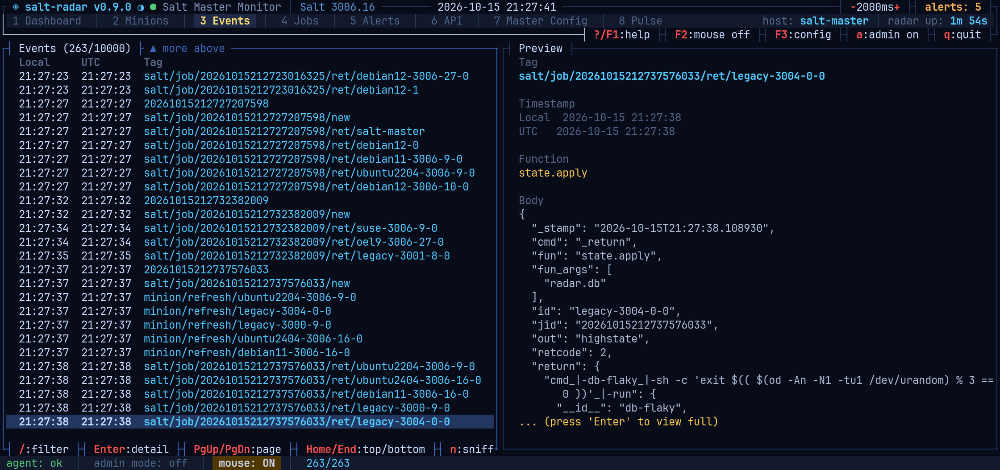
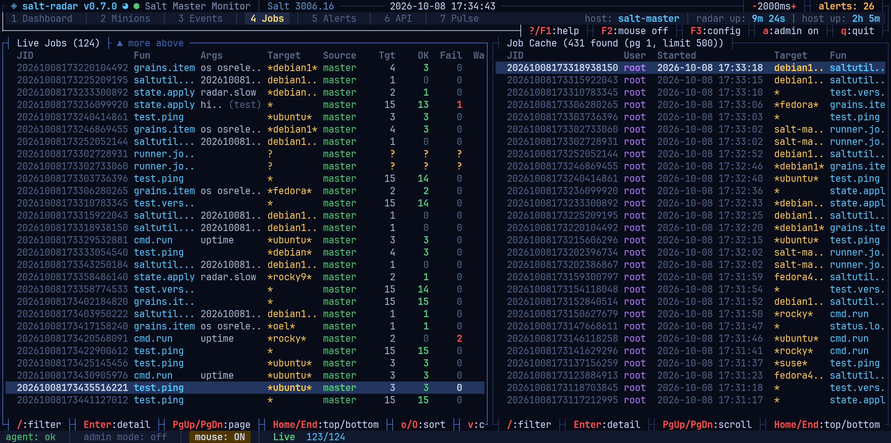
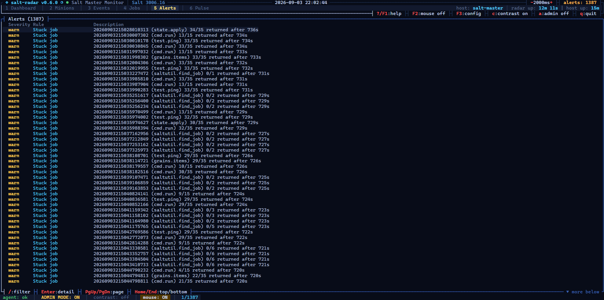
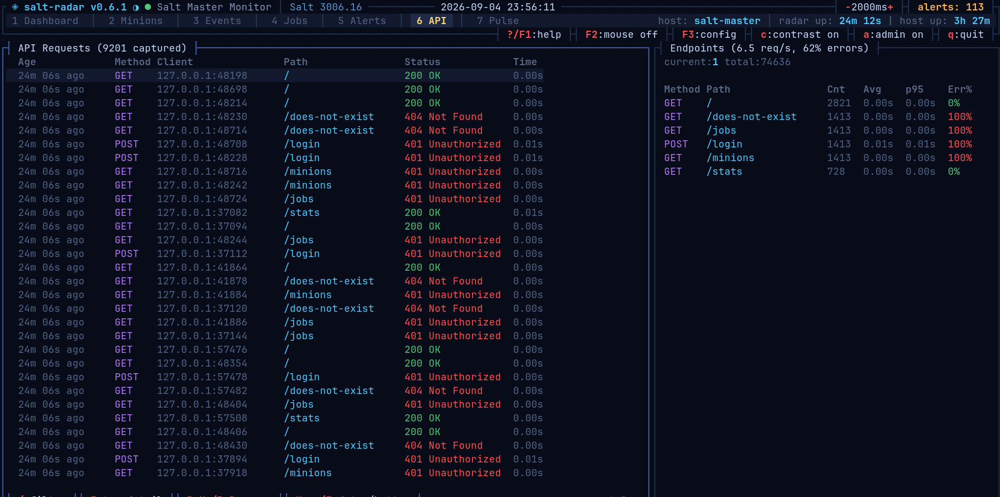
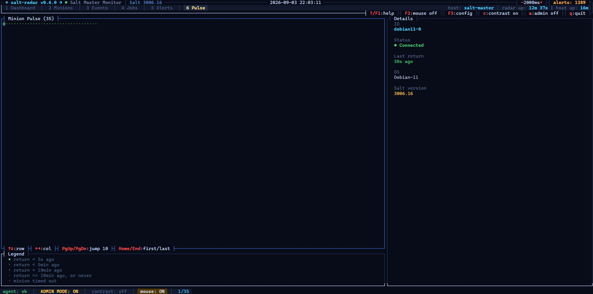

<p align="center">
  
  
  
  
  
</p>

<h1 align="center">salt-radar</h1>

<p align="center">
  <b>A non-intrusive, read-only TUI for monitoring a Salt Master</b><br>
  Built with <a href="https://github.com/ratatui-org/ratatui">ratatui</a> + <a href="https://github.com/crossterm-rs/crossterm">crossterm</a>
</p>

<br>

salt-radar gives you a live, at-a-glance view of your Salt Master infrastructure — directly in your terminal. It reads from `/proc`, `systemctl`, and Salt's own APIs (via a bundled Python agent) to show you what's happening without needing the Salt CLI or web UI.

No database, no web server, no JavaScript. Just a single binary and a Python agent.

## Screenshots

<table>
<tr><td colspan="2">

**Dashboard** — host resources, real systemd services, minion keys, event types, job pulse, and live ZMQ/event/minion activity sparklines


</td></tr>
<tr>
<td width="50%">

**Minions** — fleet list plus OS/version/arch distribution


</td>
<td width="50%">

**Events** — live event bus stream with pretty-printed detail preview


</td>
</tr>
<tr>
<td width="50%">

**Jobs** — live jobs from the event bus alongside the paginated job cache


</td>
<td width="50%">

**Alerts** — 14 rules covering minion staleness, keys, service health, memory, disk, jobs, auth, and API latency


</td>
</tr>
<tr>
<td width="50%">

**API** — live salt-api request log and per-endpoint breakdown, built from cpstats


</td>
<td width="50%">

**Pulse** — per-minion return activity at a glance, with connection detail on the side


</td>
</tr>
</table>

## Features

### Dashboard
Live overview of your Salt Master with real-time sparkline panels:

- **Host Resources** — CPU load, memory usage, disk usage (cache + PKI)
- **Services** — All `salt-*.service` units auto-discovered via systemctl, with active state, memory, uptime, a rolling 24h restart/flap count (`Flp`), and a memory-growth trend arrow (`T`)
- **Minion Key Status** — Accepted / Denied / Unaccepted / Rejected key counts, plus new-pending-keys-per-minute
- **ZMQ** — established connection counts per port (pub/ret/api), plus a latency sparkline whose source is configurable (`zmq_latency_source`): a local agent liveness ping (default), a real `test.ping` round-trip over the event bus, or Salt's own `master_stats` instrumentation
- **Event Rate** — Events/sec sparkline with peak and total counters
- **Minion Activity** — Job return rate sparkline with last-active minion tracking
- **CPU / Memory** — utilization-history sparklines, toggle alongside the other three sparkline panels via `show_*_graph`; stacking order of all five panels is configurable via `graph_order` — in the Config Editor (`F3`, edited as a reorderable list: `↑↓` to select, `+`/`-` to move) or by hand in `salt-radar.toml`
- **Job Pulse** — Active jobs with progress bars, rolling success rate, stuck-job count, and p50/p95 completion latency. Shares a row with salt-api (side by side) when both are shown, since neither needs the terminal's full width; Job Pulse alone takes the full row when salt-api isn't shown
- **salt-api** — shown only when a `salt-api` process is detected; request rate, error rate, `POST /login` p50/p95 latency, in-flight/total request counts, and the most recent request per worker thread (path, status, timing). Needs `rest_cherrypy: {collect_stats: True, stats_disable_auth: True}` in the master config — salt-radar polls `GET /stats`, salt-api's own built-in in-memory request-stats endpoint (CherryPy's `cpstats`), which records the request line, client, status and timing entirely in process memory. This is a different mechanism from Salt's `log_level`/access logging: nothing is ever written to disk, and the request *line* it records never includes the body — so credentials sent in a POST body (e.g. `/login`) are never captured. `stats_disable_auth` is required because salt-radar's agent never handles or stores salt-api auth tokens. Request rate is a real recent figure (computed by salt-radar from the delta between polls); error rate and login latency are also tracked by salt-radar itself, since cpstats only exposes a lifetime-average rate and a live per-thread snapshot, not cumulative error/latency counters of its own.
  - **Security tradeoff of `stats_disable_auth`**: this setting removes Salt's normal auth-token requirement for the `/stats` endpoint specifically, so once enabled, *anyone who can reach salt-api's REST port* can poll `/stats` with no credentials — not just salt-radar. What leaks to that caller: request lines including query strings (so API endpoint paths/usage patterns), client IP:port, response status, and timing — but never request/response bodies or headers, so auth tokens and credentials (including `POST /login` payloads) are never exposed this way. The risk is proportional to how exposed salt-api's port already is: low if it's bound to localhost or a trusted management network, real if it's reachable more broadly. If that matters in your environment, firewall salt-api's port to trusted hosts before enabling `stats_disable_auth`, or don't enable `collect_stats` at all and skip the salt-api panel.
- Every panel above the sparklines — Host Resources, Services, Minion Key Status, Event Types, Job Pulse, salt-api — can be individually hidden via `show_host_resources`/`show_services`/`show_key_status`/`show_event_types`/`show_job_pulse`/`show_salt_api` in the Config Editor (`F3`), same on/off toggle as the sparkline panels' `show_*_graph`; hiding one of Services/Minion Key Status/Event Types reflows the remaining columns in that row to fill the freed width instead of leaving a gap

### Minions
- Scrollable minion list with dynamic column widths (ID, OS, Salt Version, Arch)
- Freshly-active marker (`●`) next to minions that checked in recently, threshold adapts to the fleet's own median check-in age
- Fleet overview panel: OS Distribution, Salt Version, and Architecture distribution bars
- Detail popup with key info and connection status
- Filter by ID, OS, or version (`/` key)

### Events
- Live event stream from the Salt event bus (via ZMQ)
- Full date/time in local and UTC columns
- Filter by tag, function, minion ID, or any JSON field
- Event detail popup: copy to clipboard (`y` = tag/timestamp + pretty-printed data, `Y` = raw JSON data only)
- Advanced **Event Sniffer** — filter events by minion ID substring (`n` key):
  - Pause/resume live capture (`p`)
  - Navigate events with full pretty-printed JSON body
  - Open event detail from sniffer (`Enter`), return to sniffer on close
  - Copy all captured events to clipboard (`y`)

### Jobs
- Split panel: **Live Jobs** (left) from event bus and **Job Cache** (right) from Salt's master job cache
- Job cache supports pagination (`[`/`]` adjust limit, `,`/`.` page navigation) and server-side search
- Per-minion return navigation (j/k), scrollable output viewer (Enter)
- Copy return output to clipboard (y = Salt outputter format, Y = raw JSON)
- Job detail popup shows correct OK/FAIL status derived from return values
- Always shows full per-state detail (`--state-output=full --state-verbose=True`), regardless of the master's own `state_output`/`state_verbose` defaults — opening the popup is an explicit request to see everything about that one job, even a "terse"/"changes" master would otherwise hide unchanged/no-op states here

### Pulse
- Per-minion return activity at a glance: every minion as a dot in a wrapped grid, color- *and* shape-tiered by recency (`●` bright green flash → `•` green → `·` orange → `·` grey → `·` red for timed out) so adjacent tiers stay distinguishable even at a glance
- Scales from a handful of minions to 4,000+ without layout changes
- Detail panel on the side: key status, connection status, OS, Salt version, last return time

### Alerts
14 rules, evaluated every tick and de-duplicated (repeat firings bump a counter instead of spamming new entries):

- **Stale minion** — not seen within `stale_minion_secs`
- **Pending key** — pending longer than `pending_key_secs`
- **Service down** — a discovered `salt-*.service` unit is inactive
- **Disk usage high** — cache or PKI disk over `disk_usage_pct`
- **Legacy protocol** — minions still using Salt's legacy transport
- **Salt warning** — `salt/warning/*` events on the bus
- **Auth failure** — failed authentication on the ZMQ bus
- **Stuck job** — dispatched but not fully returned within `job_straggler_secs`
- **Reauth storm** — auth rate and worker-pool saturation elevated together (`auth_storm_rate_per_sec`, `worker_saturation_pct`)
- **Pending key churn** — new pending keys arriving faster than `pending_key_churn_per_min`
- **Service flapping** — a unit restarted more than `service_flap_threshold_24h` times in 24h
- **Service memory growth** — sustained upward memory slope past `service_mem_growth_mb_per_hour`, independent of flapping
- **Service memory high** — a unit's current RSS crosses an absolute (`service_mem_abs_threshold_mb`) or percent-of-total-memory (`service_mem_pct_threshold`) threshold, independent of growth rate; salt-master/minion/api/syndic can each override these globals (e.g. `service_mem_abs_threshold_master_mb`)
- **API auth latency** — salt-api's `POST /login` p95 processing time crosses `api_auth_latency_warn_secs`, a common early symptom of PAM/LDAP/eauth backend trouble (needs the salt-api panel's `collect_stats` setup — see Dashboard above)

All thresholds are configurable via `salt-radar.toml` or the in-app Config Editor (`F3`).

### API
Shown only once salt-api's `/stats` is reachable (see Dashboard above for the `collect_stats`/`stats_disable_auth` setup):

- Live request log — age, method, client, path, status, timing — built by salt-radar itself from cpstats' per-thread snapshots (filterable by `/`); `Enter` opens a detail popup with the full request line (query string included), client, status, and processing time
- Per-endpoint breakdown — request count, avg/p95 latency, error rate, grouped by method+path
- Best-effort, not a complete record: cpstats only ever exposes the *latest* request per CherryPy worker thread, so a thread that completes more than one request between two polls only shows the last one
- Bounded two ways, both configurable under `[api]` (`log_cap`, default 1000; `log_max_age_secs`, default 3600): capped at `log_cap` entries, and entries older than `log_max_age_secs` are pruned every poll regardless of how full the log is. The salt-api panel's own error-rate/login-latency rolling window (`stats_window`, default 200 requests) lives in the same section.
- Only what cpstats records is ever visible: no request/response body, no headers — so no credentials, payload content, or which minion/job/user was involved
- salt-radar's own `GET /stats` poll (the request that populates this log) is filtered out by default — `hide_stats_polls` (`[api]`, default `true`) — since at the Dashboard refresh interval it would otherwise drown out real traffic with one entry per tick. Set to `false` to see it too.

### Admin Mode
- Toggle with `a` (danger-zone confirmation dialog required)
- **Fleet scan** (`s`): runs `grains.items` on all minions via Salt LocalClient, populates OS/Salt Version/Arch data

### Config Editor
- `F3` opens an in-app editor for every setting in `salt-radar.toml`, grouped by section
- Free-text fields edit inline; fields with a fixed set of valid values (e.g. `zmq_latency_source`) open an inline picker — arrow keys to move, `Enter` to confirm
- `graph_order` opens as a reorderable list instead of free text — `↑↓` selects an item, `+`/`-` moves it up/down, `Enter` confirms, `Esc` reverts — since hand-typing a comma-separated list makes it easy to typo or drop a panel
- `Save & Restart` writes the TOML file and applies the new config immediately, no process restart needed

### Clipboard

Copy-to-clipboard (`y` / `Y`) uses two methods:

1. **tmux load-buffer** — pushes text into the tmux paste buffer via OSC 52 escape sequence. MobaXterm (or any terminal emulator that handles OSC 52) captures this and places it on the system clipboard. Works automatically when running inside tmux. Requires `set -g set-clipboard on` in `~/.tmux.conf` to push to the system clipboard (without it, content is only available via `Ctrl+b ]` inside tmux).

2. **xclip** — pushes text to the X11 clipboard via `su` as the user that owns the X11 socket. The code auto-resolves DISPLAY and XAUTHORITY by checking the process environment first, then falling back to the tmux session's global environment, and finally trying the detected user's default `~/.Xauthority` path. This means clipboard works even when salt-radar is launched under `sudo`, with no `sudoers` configuration required.

If DISPLAY and XAUTHORITY can't be resolved, a transient yellow hint is shown in the status bar explaining that X11 clipboard is unavailable. Run with `ssh -X` or `ssh -Y` to enable X11 forwarding.

### Everywhere
- **High-contrast selection mode** (`c`) — steel-blue background + bold, works inside popups too
- **Clipboard integration** — tmux load-buffer + xclip via X11 forwarding. DISPLAY and XAUTHORITY are auto-resolved from the process environment or the tmux session's global environment — no manual configuration needed even when running under `sudo`
- Filter-as-you-type with `/` on all list tabs
- Keyboard-driven navigation with `?` for help

## Installation

### Requirements
- A Salt Master (reads `/etc/salt/master`, connects to the Salt event bus)
- Python 3 with the `salt` package installed
- **Optional — clipboard:** `xclip` (for X11 clipboard integration). Not required when using tmux with `set -g set-clipboard on` and a terminal that supports OSC 52 (MobaXterm, iTerm2, etc.)

### From source

```bash
git clone https://github.com/naqoyqatsi83/salt-radar.git
cd salt-radar
cargo build --release
```

The binary will be at `target/release/salt-radar`.

### Configuration

Copy the example config and adjust as needed:

```bash
cp salt-radar.toml.example salt-radar.toml
```

All settings are optional and can also be edited live from inside the app (`F3`), which writes the file back on save — the Config Editor's own bottom border shows exactly which file it's writing to. salt-radar looks for `./salt-radar.toml` in the current directory first (so a per-directory config still works, e.g. if you copied the example there); if that's not present, it falls back to `$XDG_CONFIG_HOME/salt-radar/salt-radar.toml` (usually `~/.config/salt-radar/salt-radar.toml`), creating the directory on first save. See [`salt-radar.toml.example`](salt-radar.toml.example) for the complete, commented list of every setting (connection paths, refresh intervals, event buffer sizes, all alert thresholds including per-unit memory overrides, and the Dashboard's `zmq_latency_source`/`show_*_graph`/`graph_order` settings) — a representative slice:

```toml
[salt]
# master_config = "/etc/salt/master"

[refresh]
dashboard_secs = 2

[alerts]
stale_minion_secs = 3600
disk_usage_pct = 85.0
service_mem_abs_threshold_mb = 2048.0

[dashboard]
zmq_latency_source = "agent_ipc"  # or "job_ping", "master_stats"
```

## Keyboard Shortcuts

| Key | Action |
|-----|--------|
| `q` | Quit |
| `Tab` | Switch tab |
| `1`–`7` | Jump to tab (Dashboard/Minions/Events/Jobs/Alerts/API/Pulse) |
| `↑`/`↓` | Scroll / navigate |
| `PgUp`/`PgDn` | Page scroll |
| `Enter` | Open detail popup |
| `Esc` | Close popup / help |
| `/` | Filter (current tab) |
| `a` | Toggle admin mode |
| `c` | Toggle high-contrast selection |
| `?` / `F1` | Help overlay |
| `F2` | Toggle mouse mode |
| `F3` | Open Config Editor |
| `+`/`-` | Adjust refresh interval |
| `m` | Toggle sparkline style (Dashboard) |
| `F4`–`F8` | Toggle CPU/Memory/ZMQ/Events/Minion-activity graphs (Dashboard) |

Most of these are also shown live, btop-style, in the border of the panel they affect (e.g. the title frame's bottom border shows `-2000ms+` for the current refresh interval) — the table above is the full reference.

### Per-tab

| Tab | Key | Action |
|-----|-----|--------|
| Events | `n` | Launch event sniffer |
| Minions | `r` | Minion event/return history popup |
| Minions | `s` | Fleet scan (admin mode only) |
| Minions | `x` | Hide/show non-responsive minions |
| Minions | `z` | Collapse/expand timed-out minions into one row (when not hidden) |
| Jobs (Cache) | `/` | Filter cache entries (server-side) |
| Jobs (Cache) | `[`/`]` | Decrease/increase page limit by 500 |
| Jobs (Cache) | `,`/`.` | Previous/next page |
| Jobs (Cache) | `r` | Refresh job cache |
| Jobs (Cache) | `←`/`→` | Switch focus between Live Jobs and Cache panels |
| Pulse | `↑`/`↓`/`←`/`→` | Navigate the minion grid |

### Config Editor

| Key | Action |
|-----|--------|
| `↑`/`↓` | Move between fields |
| `Enter` | Edit field / open picker (fixed-option fields) / confirm picker selection |
| `Esc` | Cancel edit or close the picker without changing the value |

### Popups

| Key | Action |
|-----|--------|
| `y` | Copy to clipboard |
| `Y` | Copy raw JSON (job detail) |
| `j`/`k` | Next/previous return (job detail) |
| `PgUp`/`PgDn` | Jump 10 returns |
| `Home`/`End` | First/last return (job detail) |
| `Enter` | Enter scroll mode (event/job detail) |
| `Esc` | Exit scroll mode |
| `Home`/`End` | Jump to start/end of output (scroll mode) |
| `h` | Edit highlight keywords (sniffer) |
| `p` | Pause/resume (sniffer) |
| `g` | Fetch grains for this minion (minion detail, admin mode only) |

## How It Works

```
┌───────────────────────────────────────────────────────────┐
│                   salt-radar (Rust TUI)                   │
├─────────┬─────────┬─────────┬─────────┬─────────┬─────────┤
│   Dash  │ Minions │  Events │   Jobs  │  Alerts │  Pulse  │
├───────────────────────────────────────────────────────────┤
│          Python Agent (ZMQ, client, fleet scan)           │
├───────────────────────────────────────────────────────────┤
│          Rust: /proc, systemctl, ZMQ, clipboard           │
│           Salt Master: ZMQ bus, PKI, job cache            │
└───────────────────────────────────────────────────────────┘
```

The Rust TUI spawns a Python agent subprocess and communicates via NDJSON over a file-based command queue. The agent subscribes to the Salt event bus (ZMQ) and dispatches commands to Salt's client/runners. Meanwhile, the Rust side collects OS-level data directly from `/proc` and `systemctl` for the dashboard panels.

All data stays local — no external dependencies, no database, no HTTP server.

### A note on the two memory numbers on the Dashboard

The **Services** panel shows two different memory readings that measure different
things and are not expected to match:

- **Per-role breakdown** (`Master x4: 212MB`, `Worker x5: 299MB`, etc.) — the sum
  of each individual process's own RSS (`/proc/<pid>/stat`), independently, across
  every process matching that role. Since Salt's Worker/ReqServer/EventPublisher
  children are forked from the master and share most of their loaded code/library
  pages with it via copy-on-write, summing their RSS independently counts those
  shared pages once per process — so this number is a reasonable *upper bound*,
  not the service's true footprint.
- **`Unit` table memory** (`salt-master.service 51 MB`) — the systemd unit's
  cgroup memory accounting (`MemoryCurrent`), which counts each physical page
  once no matter how many of the service's processes share it, and covers the
  whole process tree (main daemon plus all forked children). This is the more
  accurate figure for "how much RAM does this service actually cost."

If cgroup memory accounting isn't available for a unit, the `Unit` table falls
back to the main process's own `VmRSS`, which — like the per-role breakdown —
only reflects that one process, not its forked children.

## Development

```bash
# Build
cargo build

# Run with live config
cargo run

# Release build
cargo build --release
```

### Project Structure

```
src/
├── main.rs              # Terminal setup, event loop, tick scheduling
├── app.rs               # Application state, key handling, clipboard
├── types.rs             # Data types (minion, event, job, alert, etc.)
├── config.rs            # TOML config loading
├── agent.rs             # Python agent subprocess management
├── alerts/              # Alert engine (14 rules: staleness, keys, services, memory, disk, jobs, auth, api)
├── collectors/          # OS-level data collection
│   ├── keys.rs          # PKI key file parsing
│   ├── processes.rs     # /proc scanning for salt processes
│   ├── services.rs      # systemctl service discovery
│   ├── connections.rs   # /proc/net/tcp for ZMQ connections
│   └── system.rs        # System load, memory, disk usage
└── ui/                  # Terminal UI
    ├── mod.rs           # Master draw, theme, title/tab frame, key hints, help
    ├── dashboard.rs     # Dashboard tab
    ├── minions.rs       # Minions tab
    ├── events.rs        # Events tab
    ├── jobs.rs          # Jobs tab
    ├── alerts_view.rs   # Alerts tab
    ├── api_view.rs      # API tab
    ├── pulse.rs         # Pulse tab
    ├── minion_events.rs # Per-minion event/return history popup
    ├── config_editor.rs # In-app config editor (F3)
    └── detail_popup.rs  # All other popup windows (minion, event, job, sniffer, etc.)
agent/
└── salt_radar_agent.py  # Python agent: Salt client, event subscriber, fleet scan
```

## License

MIT — see [LICENSE](LICENSE).

salt-radar is not affiliated with or endorsed by SaltStack / VMware / Broadcom.
